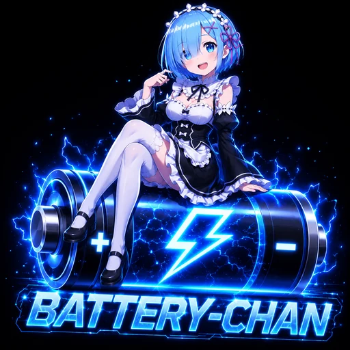

# Battery Chan

**Battery Chan** is a feature-rich Android battery monitoring application that combines aesthetics with deep technical insights. Featuring custom alerts, anime-themed visuals, and a live status bar indicator, it ensures you always know exactly what\'s happening with your device\'s power.

## ✨ Features

- **Detailed Battery Stats**: Real-time monitoring of Voltage, Energy (Wh/Ah), and Temperature.
- **Live Watt Meter**: A big live reading on the home screen showing how many watts your phone is charging or draining at right now.
- **Custom Events**: Create your own events at any battery level (1-100%). Choose whether they fire while charging up, while draining, or both, then give each one its own image, GIF or video, sound and message.
- **Anime Alerts**: Personalize your battery milestones (Low Battery, Charging Connected, Full Charge, Unplugged) with custom:
    - 🖼️ Images, GIFs and videos (they play automatically in the pop-up)
    - 🎵 Audio / Sound effects
    - 💬 Custom Text
- **Live Status Bar Indicator**: A ported and optimized power indicator that shows your battery\'s status directly in the status bar icon area.
- **Pop-up Notifications**: Eye-catching pop-up alerts that appear over other apps when battery events occur.
- **Deep Monitoring**: Keeps track of "Charging Since" and "Time to Full" estimates.

## 🚀 Getting Started

1.  **Enable Monitor**: Tap the main button to start the background service.
2.  **Personalize**: Go to "Personalize events" to set up sounds and images for the built-in states, or tap "Add custom event" to create your own (for example: at 80% while charging).
3.  **Optimize**: Click the battery optimization warning at the bottom to ensure the app isn\'t killed by Android\'s power management for consistent monitoring.

## 🛠 Technical Details

- **Version**: 1.1.0 (Build 110)
- **Min SDK**: 29 (Android 10)
- **Target SDK**: 36
- **Developed by**: Paradox
- **Ported Logic**: Detailed metrics engine and status bar rendering adapted from the Wattz project.

## ⚖️ Permissions

To provide full functionality, the app requires:
- `POST_NOTIFICATIONS`: To show event alerts and the status bar indicator.
- `SYSTEM_ALERT_WINDOW`: To display pop-up alerts over other applications.
- `REQUEST_IGNORE_BATTERY_OPTIMIZATIONS`: To keep the monitor running accurately in the background.

---
*Made with ⚡ by Paradox*

## 📦 F-Droid

Store listing text, icon, changelogs and screenshots live in `fastlane/metadata/android/en-US/`.
Changelog files are named after the `versionCode` (`changelogs/110.txt`), so add a new file
for every release. A draft build recipe is in `fdroid/com.tg.batterychan.yml`.

## 📄 License

Battery Chan is released under the [MIT License](LICENSE). Third-party notices are in
[NOTICE.md](NOTICE.md).

## 🧾 Changelog

### 1.1.0
- New: user-defined custom events (name, battery level, trigger direction, image, sound, message). They can be edited, disabled and deleted.
- New: per-event enable switch for every event.
- New: Material 3 UI, Material You dynamic color, System / Light / Dark / Black themes.
- New: option to turn off "max volume" for event sounds.
- Fix: testing an event played the sound twice (echo). The pop-up now owns playback, only one player can exist at a time, and the notification channel is silent.
- Fix: a second event arriving while the pop-up was open was ignored; it now replaces the first one.
- Size: R8 code and resource shrinking enabled, launcher logo reduced from 1.8 MB PNG to a WebP, Glide and unused AndroidX libraries removed, unused permissions and drawables removed.
